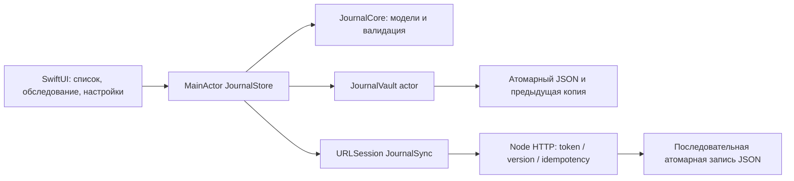

# Журнал, устройство и сервер

Локальные записи остаются основным рабочим набором. Синхронизация опциональна: отправляет известные устройству изменённые записи, а не обнаруживает все новые записи на сервере. Обмен полным набором доступен через JSON-копию. UI и ядро отделены, чтобы доменные проверки запускались через Swift Package Manager без симулятора.

revision изменяется локально; remoteRevision хранит последнюю подтверждённую сервером версию. If-Match защищает от перезаписи чужого изменения; повтор одного запроса распознаётся ключом идемпотентности и содержимым. При неоднозначном результате сеть можно повторить. Сервер не обещает exactly-once внешних действий.

Отправка не блокирует редактирование. Подтверждение обновляет remoteRevision, сохраняя изменения, сделанные пока запрос выполнялся. Разрешение конфликта захватывает идентификатор до закрытия диалога. Перед заменой серверной версией проверяется, что локальная revision не изменилась за время await; иначе новые правки сохраняются и пользователь повторяет решение. Импорт и восстановление предыдущей копии блокируются на время обмена, чтобы позднее подтверждение не попало в другой рабочий набор. Загруженная серверная запись проходит те же проверки схемы и размера, что и импорт.

Хранилище сериализует обращения actor-ом и проверяет отмену перед записью. Дебаунс уменьшает число записей; уход приложения в фон вызывает flush. Одна предыдущая копия помогает восстановиться после повреждения текущей, но не заменяет отдельный backup. Фото входят в JSON; лимит общего размера проверяется до изменения рабочего набора.

Вопросы для разбора на интервью:

- Почему MainActor не защищает от логических гонок между двумя await и как сохраняются правки во время синхронизации?
- Как добавить загрузку новых удалённых записей: cursor, tombstones и восстановление после пропуска истории?

Статус проверки: Node sync API выполнен на Windows. Swift unit tests, iOS build, камера, VoiceOver и жизненный цикл на устройстве требуют Mac/Xcode и пока не подтверждены.
